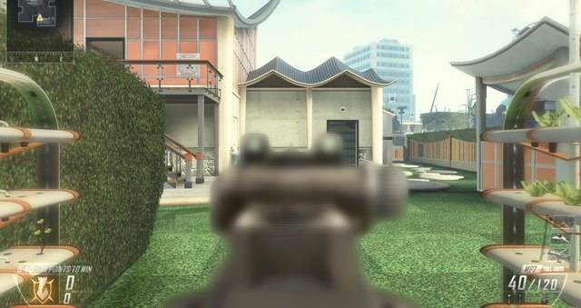
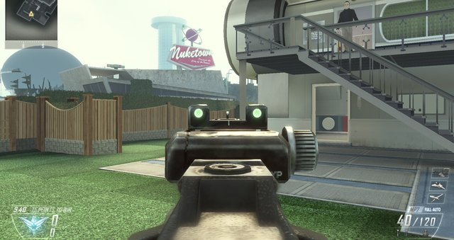
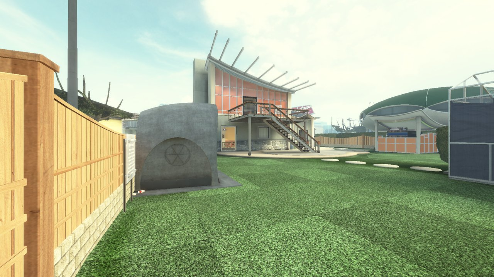

# BO2 Multiplayer Rebuild

A fan rebuild of Call of Duty: Black Ops II multiplayer in an engine written in Rust, built to feel exactly like
Black Ops II: its movement, gunplay, rules, menus and bots. It is a fork of [IW4L](https://github.com/vladtrc/iw4L),
an open-source Call of Duty runtime built on [Bevy](https://bevyengine.org/) and [wgpu](https://wgpu.rs/), and runs
Black Ops II's own multiplayer scripts without ever starting the original executable.

On top of Black Ops II it brings in the classic era's other games, played under Black Ops II's rules:

- **Maps** from Call of Duty 4, World at War (custom maps too), Modern Warfare 2, Modern Warfare 3 and Black Ops,
  with each game's own lighting, fog and soldiers; Ghosts maps are in progress (Prison Break first).
- **Guns** from Black Ops, Modern Warfare 2 and Ghosts as extra weapons in Create-a-Class.
- **Online play**: host on your PC, a friend's PC or a VPS; friend codes, a friends list, lobby browser and joining a
  friend's lobby in one press ([docs/ONLINE.md](docs/ONLINE.md)).
- **Zombies**: every Black Ops II Zombies map through the companion Zombies rebuild.

**No game files are included.** This repository holds no Black Ops II (or any other Call of Duty) files: no maps,
models, textures, sounds, scripts or executables. You need your own legally owned copy of Black Ops II for PC with
Multiplayer installed (and of any other game whose maps or guns you want). The engine reads that install read-only at run time and never patches, copies or
redistributes it. Unofficial fan project, not affiliated with or endorsed by Activision, Treyarch or Infinity Ward.

## Contents

- [Map completion](#map-completion)
- [Features](#features)
- [Screenshots](#screenshots)
- [Requirements](#requirements)
- [Build and run](#build-and-run)
- [Configuration](#configuration)
- [How it works](#how-it-works)
- [Status](#status)
- [Recent changes](#recent-changes)
- [Coming soon](#coming-soon)
- [Credits and license](#credits-and-license)

## Map completion

How far along each multiplayer map is, mechanically (loads, spawns, each mode, bots, scorestreaks, killcam, match
end) and visually (fixed spots shot in the original game and here from the same place, side by side). Every number
comes from [docs/maps.json](docs/maps.json), where each passing item names the test run or screenshot that proves
it; [docs/make_bars.py](docs/make_bars.py) draws this table. A visual spot only counts once it has a same-spot
comparison shot from the original, so visuals read 0% until those shots are taken.

<!-- map-bars:start -->
```text
                Mechanics         Visuals
Aftermath       ████░░░░░░  38%   not compared yet
Cargo           ██░░░░░░░░  25%   not compared yet
Carrier         ██░░░░░░░░  25%   not compared yet
Drone           ██░░░░░░░░  25%   not compared yet
Express         ██░░░░░░░░  25%   not compared yet
Hijacked        ██░░░░░░░░  25%   not compared yet
Meltdown        ██░░░░░░░░  25%   not compared yet
Overflow        ██░░░░░░░░  25%   not compared yet
Plaza           ██░░░░░░░░  25%   not compared yet
Raid            ██░░░░░░░░  25%   not compared yet
Slums           ██░░░░░░░░  25%   not compared yet
Standoff        ██░░░░░░░░  25%   not compared yet
Turbine         ██░░░░░░░░  25%   not compared yet
Yemen           ██░░░░░░░░  25%   not compared yet
Nuketown 2025   ███████░░░  72%   not compared yet
Downhill        ██░░░░░░░░  25%   not compared yet
Mirage          ██░░░░░░░░  25%   not compared yet
Hydro           ██░░░░░░░░  25%   not compared yet
Grind           ██░░░░░░░░  25%   not compared yet
Encore          ██░░░░░░░░  25%   not compared yet
Magma           ██░░░░░░░░  25%   not compared yet
Vertigo         ██░░░░░░░░  25%   not compared yet
Studio          ██░░░░░░░░  25%   not compared yet
Uplink          ██░░░░░░░░  25%   not compared yet
Detour          ██░░░░░░░░  25%   not compared yet
Cove            ██░░░░░░░░  25%   not compared yet
Rush            ██░░░░░░░░  25%   not compared yet
Dig             ██░░░░░░░░  25%   not compared yet
Frost           ██░░░░░░░░  25%   not compared yet
Pod             ██░░░░░░░░  25%   not compared yet
Takeoff         ██░░░░░░░░  25%   not compared yet
All maps        ███░░░░░░░  27%   not compared yet
```

Mechanics: each map's systems and modes work by Black Ops II's rules. Visuals: set spots compared side by side with Black Ops II. Scored in [`docs/maps.json`](docs/maps.json) (pass or match 1, part or close half, not yet 0), last updated 2026-10-08; drawn by [`docs/make_bars.py`](docs/make_bars.py).
<!-- map-bars:end -->

## Features

- **Black Ops II's own front end.** `frontend t6mp` opens the multiplayer main menu built from the game's UI
  scripts: custom games lobby, Setup Game, Setup Bots, Create-a-Class, Scorestreaks, then Start Match. Classes are
  saved next to the binary.
- **Every multiplayer map.** All maps on your disc and in the DLC packs you own load and can be played, each with
  its own factions, lighting, colour grading, sky, water and foliage.
- **The game's own match rules.** Black Ops II's compiled multiplayer scripts run the match: spawns, scoring,
  score and time limits, rounds, the end of the match. The one script no PC file carries (`_globallogic`, the match
  flow) is written for the engine from what the other scripts call, and compiled by the engine's own script compiler
  (`crates/sim/src/t6/scripts/mp_globallogic.gsc`).
- **Bots.** The game's bot scripts choose goals, classes and targets; the engine walks them over the map's path
  nodes, aims, jumps, climbs ladders and fires. Bots play Team Deathmatch, Free-for-All, Domination, Kill
  Confirmed, Hardpoint, Capture the Flag, Demolition and Headquarters.
- **In the match.** The class menu at spawn, the HUD with the turning minimap, compass, clock, score bars, kill feed
  and scoreboard, the pause menu, menu sounds, the killcam, dropped guns and Scavenger bags, and the end-of-match
  screen back to the main menu.
- **Public Match.** Combat Training plays the original's map rotation, with its vote for the next map in the
  lobby.
- **Scorestreaks.** Score earns streaks through the game's own momentum code; bots call in Orbital VSAT,
  Counter-UAV, EMP, Death Machine, War Machine, Swarm, Escort Drone and K9 Unit.

## Screenshots

<!-- shots:start -->
Drawn by this engine; the art is Black Ops II's own, read from the player's install at run time.

**Aiming down the sights** (fixed 2026-10-10): the gun used to blur whenever you aimed; now the sights and the gun
stay sharp, as in the original.

| | |
|---|---|
|  |  |
| Before: the MP7 blurred while aiming | Now: sharp, as in the original |

**Nuketown 2025**, the map you play from the menus, from a spawn point with the HUD hidden (build r129, 2026-10-11).
Each other map goes on this page once it is proven started from the menus.


<!-- shots:end -->

## Requirements

- Your own Call of Duty: Black Ops II for PC (Steam) with Multiplayer installed.
- Windows x64 (built and played on Windows 11 only so far).
- Rust (stable, via [rustup](https://rustup.rs/); the code uses the 2024 edition) and Visual Studio 2022 Build Tools
  with the C++ workload (MSVC).
- A GPU with DirectX 12 or Vulkan.
- Tens of GB of free disk space for the Rust build output.

## Build and run

There are no release downloads: you build it from this source tree. These steps have been done on the author's PC
only, not yet on a fresh one by someone else.

1. Install Rust and the Visual Studio 2022 Build Tools (C++ workload).
2. Clone or download this repository.
3. Optional: set `CARGO_TARGET_DIR` to a folder on a drive with plenty of room (the default is `target\` inside the
   repository).
4. Build the game:

   ```powershell
   cargo build -p launcher --profile play
   ```

   The binary is `<target-dir>\play\iw4l.exe`.
5. Make a play folder anywhere, copy `iw4l.exe` into it, and create a `.env` file next to it that points at the
   folder holding your Black Ops II install (quoted, forward slashes), for example:

   ```text
   IW4L_GAMES="C:/Program Files (x86)/Steam/steamapps/common/Call of Duty Black Ops II"
   ```

6. From the play folder, start the multiplayer front end:

   ```powershell
   .\iw4l.exe frontend t6mp
   ```

   Pick a mode, map and bots in the custom games lobby and press Start Match. A Windows shortcut with that target
   and "Start in" set to the play folder works the same way. Keys follow Black Ops II's PC defaults; Esc opens the
   pause menu.

Settings, saved classes, caches and logs go to `iw4l-artifacts\` next to `iw4l.exe`.

Other tools: `cargo build -p bo2zm_tools --profile play` builds the zone readers described in
[`docs/BO2ZM.md`](docs/BO2ZM.md). Tests: `cargo test -p gsc_t6` (and `cargo test -p <crate>` for the others).
More documentation is indexed in [`docs/INDEX.md`](docs/INDEX.md).

## Configuration

- `.env` next to the binary: `IW4L_GAMES` (required).
- `iw4l-artifacts\settings.cfg`: saved settings; `iw4l-artifacts\bo2mp_stats.txt`: saved classes.
- Test switches for scripted test matches (`BO2MP_SCRIPTS`, `BO2MP_BOTS`, `BO2MP_GAMETYPE`, `BO2MP_AUTOCLASS`, ...)
  are listed in [`docs/BO2ZM.md`](docs/BO2ZM.md).

## How it works

On top of IW4L's engine, this fork adds the crates that read Black Ops II (`fastfile_t6`, `asset_t6`, `gsc_t6`,
`hks_t6`, `bo2zm_tools`) and the multiplayer modules in `sim`:

| Part | What it does |
|---|---|
| `fastfile_t6`, `asset_t6` | read Black Ops II's zone files from your install |
| `gsc_t6::compile` | a compiler for Black Ops II script source, for the scripts the engine must provide (`_globallogic`) |
| `sim` `t6::mp`, `natives_mp` | the multiplayer runtime: game types, team scores, the match clock, spawn choice, objectives |
| `sim` `t6::bots` | the engine half of the game's bot scripts: test clients, goals, paths, view, buttons, threats |
| `sim` `t6::loadout`, `t6::items` | classes from the game's stats table; guns and Scavenger bags on the ground |
| `hks_t6::mp`, `bo2_profile` | the game's multiplayer menus, classes and stats |

## Status

Work in progress, first playable build. Matches against Black Ops II's own bots play on every multiplayer map, started
from the game's own menus. Many menus and HUD pieces are close to the original but not one-for-one, and some
scorestreaks and effects are still missing. It has been run on one Windows 11 PC (RTX 4070 Ti class GPU, 1920x1080)
only. Like upstream IW4L, much of this code was written by an LLM (Claude), directed and play-tested by the author.

## Recent changes

- 2026-10-11 (r132): Public Match > Combat Training plays the original's map rotation: every lobby offers a NEXT
  map, the PREVIOUS one and RANDOM, with the original's own vote tiles, counts and "Time remaining" line; your vote
  picks the map that loads (most votes win, ties go to NEXT), then the lobby shows "The match is about to
  begin..." and "Game starting in N" as the original does. Maps come from a shuffled bag that never repeats the
  last two.
- 2026-10-11 (r131): Custom Games > Setup Game > Change Map works: the lobby shows the picked map's picture, name
  and mode, as the original does, and START MATCH loads that map (it used to stay on Aftermath).
- 2026-10-11 (r130): the Lightning Strike can be called in: its tablet shows where the enemies are as it opens, you
  pick three spots on the map, and the strikes land on those spots in the original's order and timing; the UAV says
  "UAV inbound" and its sweep crosses the minimap every 4 seconds, showing enemies where it finds them and fading them
  over 4 seconds, by the original's own values.
- 2026-10-11 (r129): bullets pass through players and thin surfaces the way the original works it out, using its own
  penetration table (how deep a bullet gets into each surface type), with the damage dropping after each target it
  goes through; a sniper shot can now kill the player behind the one it hits (a collateral), checked for the DSR 50,
  Ballista, SVU-AS and XPR-50 against the original's numbers; Create a Class: the weapon category list under the
  guns no longer draws names on top of each other or repeats a row, and every category screen lists the others in
  the original's order.
- 2026-10-11 (r128): the final killcam plays for everyone at the end of a match, including a player who is still
  alive (the original seats every player on it); End Game in the pause menu leaves the match, and from Combat
  Training it goes back to the Public Match menu, as the original does when the public lobby breaks up; the scripts
  that run for each life now end when a player dies, so they no longer pile up over a match (one part of the
  late-match slowdown); with vsync on, frames are queued the way the original leaves them (the graphics default of 3).
- 2026-10-10 (r127): riot-shield hits use the shield's own model from the original instead of a guessed angle, so
  shots that reach the body or legs before the shield now count, and a shield on the back still stops them; the kill
  replay draws players between the right two snapshots, the way the original does, so they move smoothly instead of
  jumping around.
- 2026-10-10: scorestreaks are earned again with Hardline (the perks' own numbers were never set, so a Hardline
  kill counted for nothing; every perk now has the original's values), the announcer speaks (match start, lead
  taken and lost, one minute left, time's up, win or loss) along with the match-end countdown, enemy names are red
  and teammates' green in the original's own colours, the class menu inside a match shows the same classes as the
  lobby, and a body no longer pops back up after the kill replay. Bots, hit markers, the dive, the riot shield, the
  death camera, the kill replay and body spin are still on the list below.
- 2026-10-10: aiming down the sights no longer blurs the whole gun (every gun, with or without an optic): the blur
  now works out each gun pixel's distance with the same near plane the gun is drawn with, so only the far end of the
  gun softens, by each weapon's own values (checked side by side against the original with the M27 + reflex sight
  and the MTAR's iron sights).
- 2026-10-10: a game no longer quits with "lost the graphics card" when the PC is busy for over a second: the
  graphics library counted a slow hand-over of a finished frame as a lost card, so it now waits again instead (a
  fixed copy of the library is in `third_party/wgpu-hal`).
- 2026-10-10: the render thread takes about 30% less time a frame (12.8 to 9.2 ms in a Nuketown match on the fast
  setting): props that share a model are drawn together (about 1,500 props in about 540 draws), posed bodies' index
  lists are sent again only when they change, bullet marks lit alike share one draw, and the body-posing pass goes
  out with the rest of the frame.
- 2026-10-10: bodies are posed on the graphics card instead of the processor, so each game window needs about half
  the processor time. 8 game windows now run at once on one PC at 27 to 29 frames a second each
  (`bo2_quality=fast`), each with about 2.1 GB of RAM and 0.9 GB of graphics memory.
- 2026-10-10: bots move and aim by the original's own rules (how fast they turn and settle their aim, where they
  look while walking, when they sprint, how fast semi-automatic guns fire, when they knife) and step around
  teammates the way the original's bots do; they judge what they can see and reach from the map's own baked node
  tables. The game thread no longer stalls: the HUD and menus only redraw values that change, settings save only
  when a menu changes them, and settled bodies stop being re-posed. Objective markers show in the objective modes.
- 2026-10-10: bodies, dropped guns and props out of view are no longer drawn, so each game window spends about a
  sixth less time preparing a frame; each window needs much less memory (Nuketown at full quality: 3.1 to 2.2 GB of
  RAM, 1.6 to 1.4 GB on the graphics card), a window without focus draws 30 times a second, and bullet marks look
  up their light once instead of every frame.
- 2026-10-10: a scorestreak from a care package waits in the inventory slot and comes out the original way: hold
  the switch-weapon key (controller Y) for a quarter second; a tap still swaps guns, now on release as in the
  original. The console's `give killstreak` hands it over through Black Ops II's own scripts. Sun shadows sit
  around the player the way the original places them, reach further ahead of where you look and no longer crawl
  as you turn.
- 2026-10-10: Nuketown's mannequins break the way the original breaks them, the match sets up spawns the way
  Black Ops II does, names show over teammates' heads, being shot no longer hangs a blood cloud at your own
  camera (only the red screen edges), and the sun casts live shadows sized for each map.
- 2026-10-10: movement closer to Black Ops II: a hit jolts your view by how hard it hit and the damage arrow
  points back at the shooter, Lightweight's speed and the original sprint recovery, a dive that stops sliding
  ends at once, a controller dive needs the stance button held, going prone takes the original 600 ms, the
  game's scripts can switch sprint, stances, knifing and aiming off and on, and a second PC predicts its moves
  with the match's own movement rules.
- 2026-10-10: a no-graphics test mode (`IW4L_HEADLESS=1`): a test match with no window, graphics card or sound
  device. A Nuketown match with bots takes about a third of the CPU, under half the memory and a seventh of the
  disk reads of a drawn one, so many test matches run at once on one PC.
- 2026-10-09: movement from the original game's own numbers: a dive needs a short sprint first, waits about
  1.5 s after the last one, pops higher and can be steered a little; falls hurt from the original heights and the
  fall-damage perk stops it; a shellshock slows your walk by the shock's own amount. The Lodestar's view snaps to
  its zoom when you aim, and your gun stays quiet while a scorestreak's view is up.
- 2026-10-09: the Lodestar puts your view on the drone with the game's own Lodestar screen (thermal at the
  start, mouse wheel up switches thermal and normal, left mouse fires missiles onto your laser, hold F to leave),
  the Killed By card shows and stays up while you are dead, bodies fall as ragdolls (the killcam replays them), the
  world blurs behind your sights and while you are dead, names over heads use the game's font, and Nuketown's cars
  break when shot.
- 2026-10-09: movement and guns closer to Black Ops II: sprint and dive in any direction, aim and fire through a
  dive, a quicker get-up, the game's own gun animations for diving, crawling, sprinting on an empty magazine and
  climbing, the fast-climb perk, and the HAMR, AN-94 and B23R fire their first shots faster.
- 2026-10-09: a launcher on a player's back hangs slung the way Black Ops II carries it, SMG and pistol kills count
  as the right kind of bullet (a rocket's direct hit is no longer cut by Flak Jacket), and the HUD reads the game's
  own weapon names.
- 2026-10-08: movement, footsteps and head bob follow Black Ops II's own rules (set BO2_FEEL=mw2 for the old
  feel); sprinting bobs the gun the way each gun does, the dive has its own rhythm, and hard landings slow you and
  take health. Prestige at level 55 (Barracks > Prestige Mode). Flashbangs and concussions last and sway your gun as
  much as the game's own files say. The Hellstorm, VTOL Warship (with its thermal view), Dragonfire and AGR show
  their own screens; helicopters and drones play their engine sounds; dual-wielded guns both kick.
- 2026-10-08: other players go prone, dive and climb ladders at Black Ops II's own animation speeds, the
  VICTORY / DEFEAT banner at match end sits where the original puts it, and the README shows per-map completion
  bars.
- 2026-10-08: Frostbite's open sea no longer shows a dark wedge beside the rooftops, and cliffs, rocks and
  mountains on 13+ maps (Hydro, Cove, Drone, Castaway...) draw Black Ops II's own tiled rock detail instead of one
  flat colour.

## Coming soon

- Bots that stop getting stuck on corners and props: the original's own stuck rescue and its look-ahead check on
  the route.
- Bots that never stand facing a wall, and always shoot at an enemy walking in front of them.
- Bots on Nuketown's upper floor: its ledge links carry no jump or drop mark, so bots walk them; match how the
  original moves its bots over them.
- A hit marker and the original's hit sound every time you hit someone, its own headshot marker and sound, and no
  marker when someone else hits you.
- Getting up from a dive at the original's speed, and diving over low objects the original way.
- Bodies that fall without spinning, the way the original's ragdolls throw them.
- Every other scorestreak proven against the original. Fixes from a check of every scorestreak against the original's
  scripts are in the game since r130 but not yet checked side by side: Care Package capture bar and prompt, K9 Unit,
  Stealth Chopper, AGR, VTOL Warship, Dragonfire, Escort Drone, Sentry Gun, Guardian, Hellstorm, RC-XD, Counter-UAV,
  EMP, Orbital VSAT, the UAV in free-for-all, streaks taking damage, and the scorestreak icons on the HUD.
- Lightning Strike's tablet looking exactly like the original's: a mark left on each picked spot, the "Press [key]
  to Target (N remaining)" line, the map inside the tablet's lit screen at the original's size and position, the
  world blurred behind it, the tablet itself at the original's size and place in view, Nuketown's map turned and
  fitted as the original does, and teammates' arrows at the original's size (the target pick, the enemies it shows
  and where the strikes land already match the original).
- The UAV's sweep sound.
- Two scorestreaks at once, and a key of your own for each scorestreak.
- Public Match map vote checked against footage of the original next: how long the first lobby's vote runs (10
  seconds for now), whether some maps come up more often than others (all equal for now), and which tile grows
  when the vote closes.
- The Combat Training lobby lists its players instead of "Searching for player..." rows.
- The Combat Training lobby's player limit as the original shows it (it says 18 Max where a 6 v 6 playlist should
  say 12).
- Every map started from the menus: Nuketown 2025 is played from them; the others are checked started directly.
- Every attachment checked against the original's own numbers and behaviour.
- FMJ: bullets go through walls and players twice as well, as the original's perk does (bullets already pass
  through at the base rate).
- Riot shield: a test that it stops shots from the front exactly as in the original (shots from behind and around
  it are checked).
- A riot shield carried on the back shows the wrong texture (a sheet of letters) instead of the original's.
- Movement speed: walking, sprint, crouch, prone and Lightweight already match the original's numbers; still to
  check the water slowdown and each attachment's aiming speed.
- A death camera that stays on your body until you respawn or the kill replay starts.
- No slowdown late in a match: the script part is fixed; the drawing time that still grows over a match is not
  found yet.
- The announcer clear over gunfire: the original turns the other sounds down while it speaks.
- The music, sound effects and voice volume sliders (only the master volume works now).
- End Game counts the quit in your stats the way the original does.
- The reflex sight's red dot as bright as the original's.
- Demolition without script errors at a kill.
- Players never start a match inside a wall.
- The next map after Nuketown.
- The Hellstorm's steer prompt key.
- The care package's drop and pick-up checked side by side against the original game.
- No-graphics test matches skip more drawing-only work, so even more fit at once.
- Playing together over LAN, and one build with Black Ops II's main menu for both Multiplayer and Zombies.

## Credits and license

- [IW4L](https://github.com/vladtrc/iw4L) by vladtrc and its contributors: the engine this fork is built on,
  Apache License 2.0.
- For Black Ops II, [OpenAssetTools](https://github.com/Laupetin/OpenAssetTools) and
  [gsc-tool](https://github.com/xensik/gsc-tool) (both GPL-3.0) were read for format facts only; none of their code
  is copied. Other projects read during development are listed in [`NOTICE`](NOTICE).
- [wgpu](https://github.com/gfx-rs/wgpu): a copy of its `wgpu-hal` 29.0.4 with one fix is in
  `third_party/wgpu-hal` (MIT or Apache-2.0, its license files are kept there).
- Black Ops II multiplayer rebuild and the Black Ops II zone, script and menu work by DaffyDabz.
- Call of Duty, Black Ops and their assets, trademarks and intellectual property belong to their owners
  (Activision). No game files are included.

Licensed under the [Apache License 2.0](LICENSE), like upstream; [`NOTICE`](NOTICE) holds the copyright notices and
the licenses of the two bundled fonts. The license covers this source code only.
